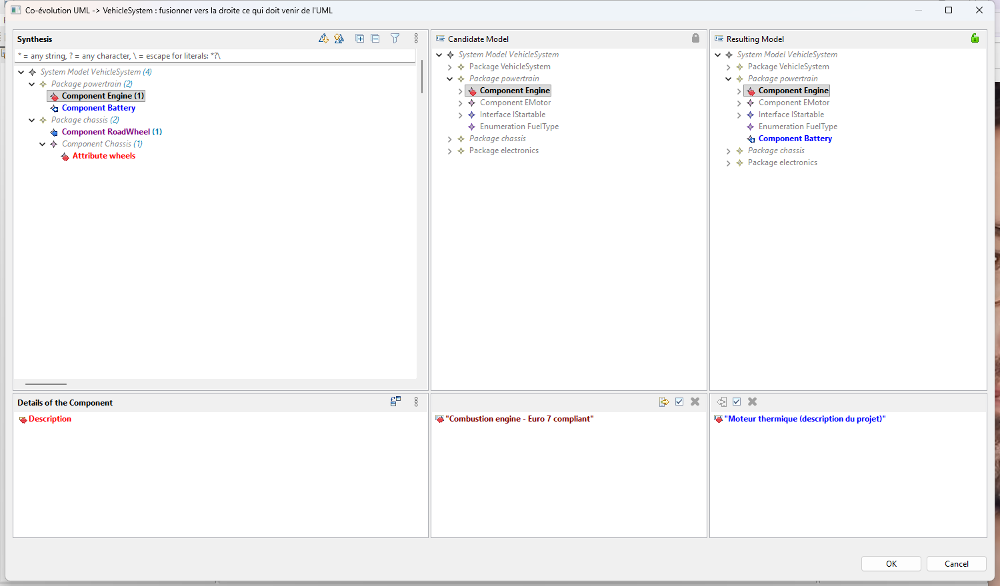

# Sysarch : prototype de co-évolution UML ↔ projets EMF (EMF DiffMerge)

Ce prototype est une application **Eclipse RCP**. Elle prouve deux choses :

1. Un fichier **UML externe contenant plusieurs modèles** s'importe en **plusieurs projets**, un par modèle. Chaque projet contient des données conformes au métamodèle EMF `sysarch`.
2. Le **mode itératif** fonctionne. Après l'import, on peut modifier le modèle UML et les projets en parallèle, puis resynchroniser autant de fois que nécessaire :
   - les changements faits côté UML sont appliqués ;
   - les changements faits côté projet sont conservés ;
   - les **conflits** sont détectés et résolus.

Technologie utilisée : **EMF DiffMerge 0.14.1**, à partir de deux sites :
- `emf-diffmerge-site` : comparaison et fusion ;
- `edm-coevolution-site` : *bridge* de co-évolution (mapping, incrémental, interactif, traces).

Documentation :
- [Guide utilisateur illustré](docs/GUIDE_UTILISATEUR.md) : les fonctionnalités en captures d'écran
- [Guide développeur](docs/GUIDE_IMPORTEUR.md) : écrire un importeur avec le même comportement
- [Référence API EMF DiffMerge](docs/API_DIFFMERGE.md) : les classes à utiliser et ce qu'elles font



## Principe

```
 fichier.uml ──(1 uml:Model)──► UmlToSysarchBridge (DiffMerge mapping bridge : queries + rules)
                                        │
          premier import ───────────────┼──► projet/<P>.sysarch  + trace + baseline
                                        │
          ré-import ─► résultat neuf (REFERENCE)
                       projet actuel   (TARGET)      ──► comparaison 3-way DiffMerge
                       baseline        (ANCESTOR)        (match par traces : cause = id UML + règle)
                                        │
          changement UML seul     → fusionné automatiquement dans le projet
          changement projet seul  → conservé
          conflit (les deux)      → dialogue : DiffMerge (UpdateDialog du bridge interactif),
                                    « garder le projet », « prendre l'UML » ou annuler
          le résultat neuf devient la nouvelle baseline
```

Le bridge incrémental natif de DiffMerge (`EMFIncrementalBridge`) compare en **2-way** : il ne sait pas d'où vient une différence, du modèle UML ou du projet. `SysarchIncrementalBridge` l'étend en **3-way** : il ajoute comme ancêtre commun le résultat du dernier import (la *baseline*). L'origine de chaque différence s'obtient avec `isAlignedWithAncestor()` / `isConflicting()` (voir `ChangeOrigin`).

## Structure

| Module | Rôle |
|---|---|
| `bundles/com.example.sysarch` (+ `.edit`, `.editor`) | Métamodèle `sysarch.ecore` et code EMF généré, éditeur arborescent compris. `Component.status` et `Component.notes` sont des données propres au projet : elles ne sont jamais importées. |
| `bundles/com.example.sysarch.coevolution` | Cœur sans UI : transformation, politiques match/diff/merge, bridge 3-way, `CoevolutionService` |
| `bundles/com.example.sysarch.coevolution.ui` | Assistant d'import, commande « Synchroniser », gestion des conflits, console de rapport |
| `bundles/com.example.sysarch.rcp` | Application RCP : advisors, perspective, produit |
| `tests/com.example.sysarch.coevolution.tests` | Scénario itératif automatisé, 5 tests |
| `tests/com.example.sysarch.doc.screenshots` | Régénère les captures de `docs/images` en pilotant l'application : `mvn verify -Pscreenshots` |
| `features/…`, `releng/…product`, `releng/…target` | Feature, produit Windows et plateforme cible : Eclipse 2024-12, DiffMerge 0.14.1, UML2, log4j (Orbit) |
| `samples/vehicle-v1.uml`, `vehicle-v2.uml` | Un fichier avec 3 modèles (2 racines et 1 imbriqué), avant et après l'évolution externe |
| `tools/emf-codegen` | Régénération du code EMF hors Eclipse : `mvn -f tools/emf-codegen/pom.xml compile exec:java` |

Fichiers d'un projet importé : `<P>.sysarch` (les données) et le dossier `.coevolution/`, qui contient :
- `link.properties` : le fichier UML source et l'identifiant du modèle ;
- `trace.bridgetraces` ;
- `baseline.sysarch` ;
- `baseline.bridgetraces`.

## Construire et lancer

Prérequis : Java 17 ou plus récent et Maven 3.9. Un accès réseau est nécessaire au premier build pour télécharger la plateforme cible.

```
mvn verify
```

- Les tests s'exécutent pendant ce build.
- Le produit est généré dans `releng/com.example.sysarch.product/target/products/sysarch-win32.win32.x86_64.zip`.
- Pour lancer l'application : `lancer-sysarch.bat`, à la racine du dépôt. Le lanceur natif `sysarch.exe` peut rester figé sur certains postes Windows (exécutable non signé).
- Workspace par défaut : `%USERPROFILE%\sysarch-workspace`.

## Scénario de démonstration

1. Copier `samples/vehicle-v1.uml` vers un fichier de travail, par exemple `C:\demo\vehicle.uml`.
2. Cliquer sur **Importer UML**, choisir `C:\demo\vehicle.uml`, puis Terminer. Trois projets sont créés : `VehicleSystem`, `Telemetry` et `ChargingInfrastructure`.
3. Ouvrir `VehicleSystem/VehicleSystem.sysarch` et faire les modifications locales suivantes :
   - `Engine` : mettre `Status = VALIDATED`, remplir `Notes`, et modifier `Description` ;
   - renommer `Wheel` en `RoadWheel` ;
   - ajouter un composant `Battery` dans `powertrain` ;
   - supprimer l'attribut `Chassis.wheels`.

   Enregistrer.
4. Simuler l'évolution du modèle externe : copier `samples/vehicle-v2.uml` par-dessus `C:\demo\vehicle.uml`. La v2 contient ces changements :
   - `ElectricEngine` est renommé en `EMotor` ;
   - `Engine` gagne un attribut `torque` et sa description change ;
   - le littéral `HYDROGEN` est ajouté ;
   - un package `electronics` apparaît, avec `ECU` ;
   - `Connector` est supprimé ;
   - `sampleRate` devient `samplingRate` ;
   - la cardinalité de `Chassis.wheels` passe à 0..6.
5. Cliquer sur **Synchroniser UML**. Deux conflits sont signalés :
   - `Engine.description`, modifiée des deux côtés ;
   - `Chassis.wheels`, supprimé dans le projet et modifié dans l'UML.

   Pour les résoudre, ouvrir *Résoudre dans DiffMerge…*, ou choisir *Garder le projet* ou *Prendre l'UML*. Tout le reste est réconcilié automatiquement : `Status` et `Notes` sont intacts, `RoadWheel` et `Battery` sont conservés, et les changements v2 sont appliqués. Le rapport s'affiche dans la console « Co-évolution UML ».
6. Resynchroniser : le résultat est « déjà à jour », sans nouveau conflit. On peut ensuite enchaîner d'autres itérations, en modifiant l'UML ou les projets.

## Limites connues (prototype)

- Les éléments UML sont reconnus grâce à leur `xmi:id`. Un fichier UML sans `xmi:id` (les identifiants sont alors des chemins de position) perd l'appariement si les éléments sont réordonnés.
- Une référence vers un type défini dans un **autre** modèle du même fichier n'est pas créée en tant que lien : seul `typeName` est renseigné, car les projets sont indépendants.
- Au démarrage, log4j affiche sur la sortie d'erreur un message bénin (`BridgeLoggingAppender` introuvable). Il vient de la configuration log4j livrée par DiffMerge. Le bundle `bridge.log4j` n'est pas inclus, parce qu'il exige un vieux bundle log4j 1.2.15.
- Le produit utilise le JRE installé sur le poste (Java 17 ou plus récent) ; aucun JRE n'est embarqué.
