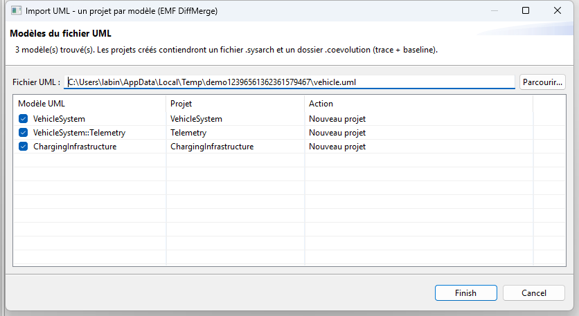
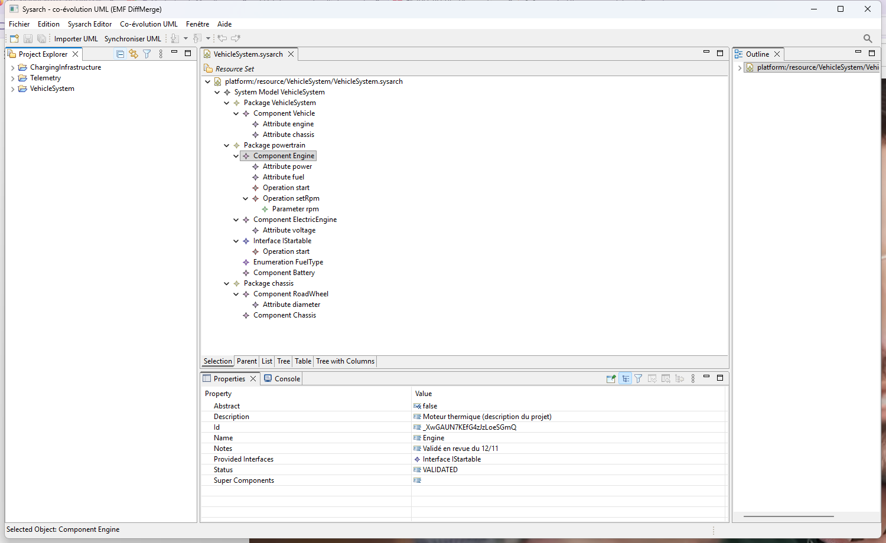
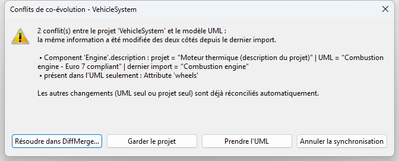
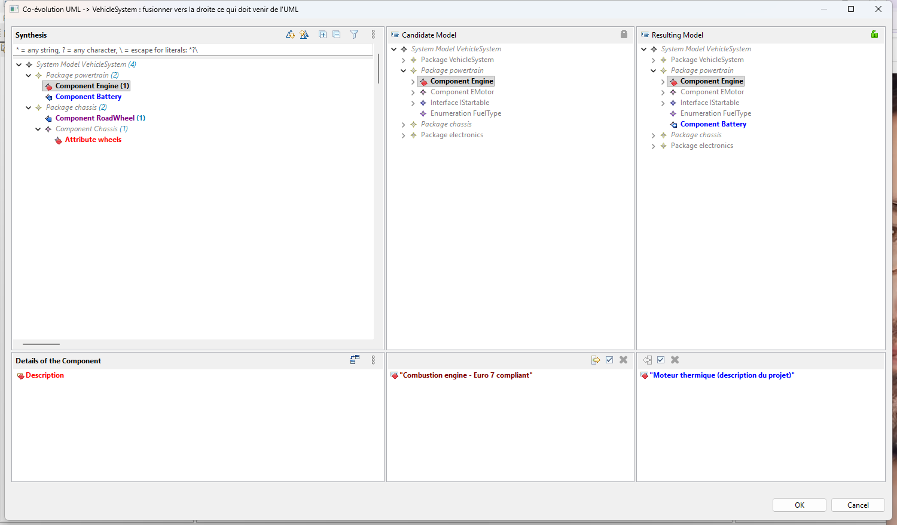
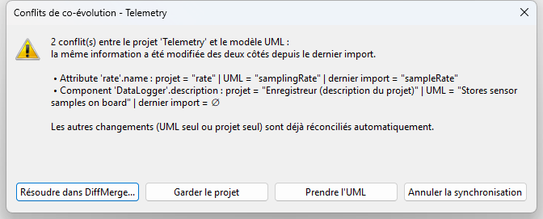
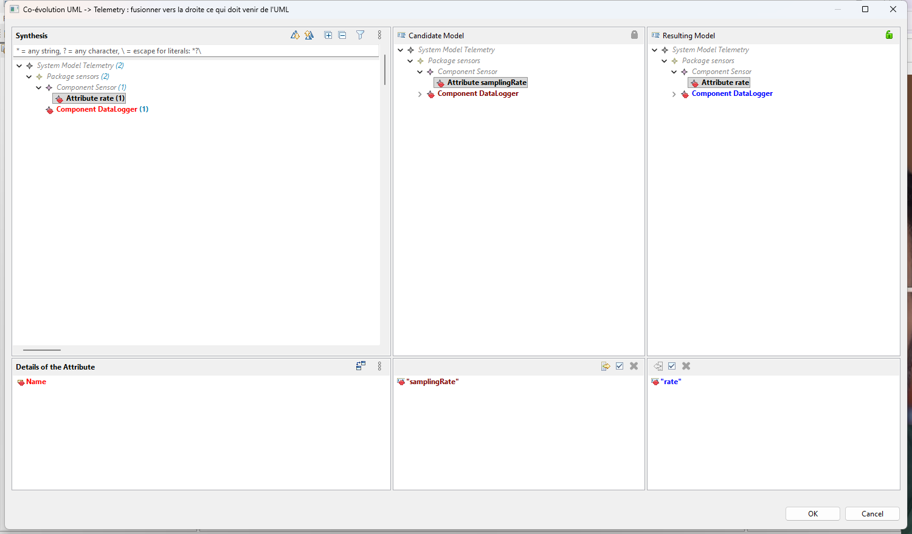
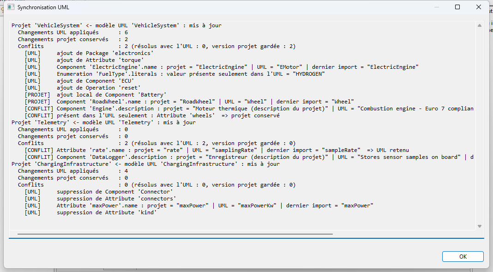
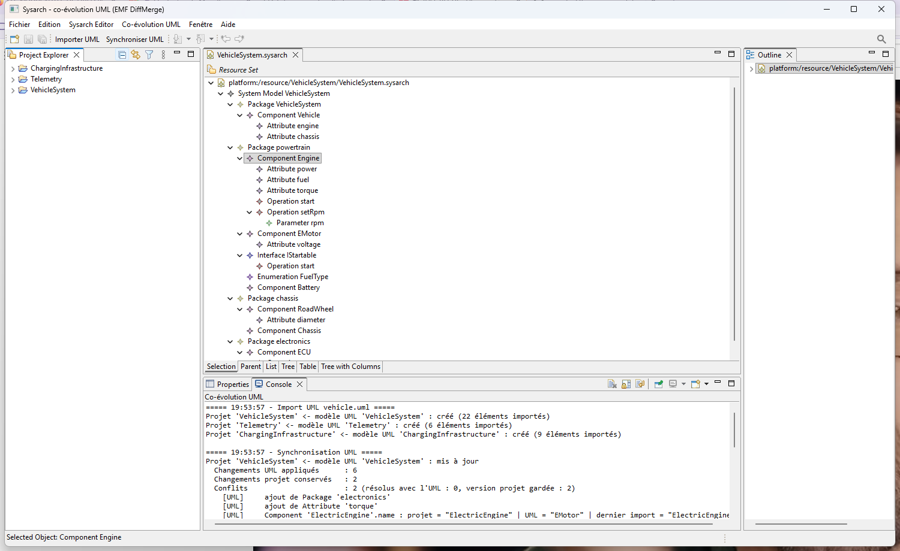
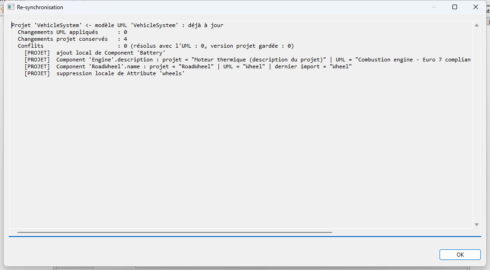

# Guide utilisateur illustré

Ce guide suit le scénario de démonstration : un fichier UML à 3 modèles est importé, les projets sont modifiés localement, puis le fichier UML évolue et on synchronise. Des conflits apparaissent dans **deux projets**.

> **Origine des captures.** Toutes les captures ont été générées automatiquement par le test `tests/com.example.sysarch.doc.screenshots`, qui pilote la vraie application.
> Pour les régénérer : `mvn verify -Pscreenshots`. Des fenêtres s'ouvrent pendant environ une minute.

---

## 1. Importer un fichier UML multi-modèles

Ouvrez **Co-évolution UML › Importer un fichier UML…** (ou le bouton *Importer UML*), puis choisissez le fichier. L'assistant liste **chaque modèle UML**, qu'il soit racine ou imbriqué, ainsi que le projet qui sera créé pour lui.

La colonne **Action** indique ce qui va se passer pour chaque modèle :

| Action | Signification |
|---|---|
| *Nouveau projet* | premier import : le projet est créé |
| *Projet existant : synchronisation itérative* | le projet est déjà lié à ce modèle : il est mis à jour en 3-way |
| *Projet existant non issu d'un import : ignoré* | un projet de même nom existe, mais il n'a pas été créé par un import : on n'y touche pas |

Chaque projet créé contient :
- `<projet>.sysarch` : les données ;
- `.coevolution/` : la trace DiffMerge, la *baseline* (résultat du dernier import) et le lien vers la source UML.

## 2. Travailler dans les projets

Les projets s'éditent normalement, avec l'éditeur arborescent et la vue *Properties*.

Sur la capture, l'utilisateur a modifié `VehicleSystem` :
- `Engine` : `Description` modifiée, et `Status` / `Notes` renseignés. Ces deux derniers champs sont des données propres au projet, que l'import ne touche jamais.
- `Wheel` est renommé `RoadWheel`.
- Un composant `Battery` est ajouté.
- L'attribut `Chassis.wheels` est supprimé.

Dans `Telemetry`, l'attribut `sampleRate` est renommé `rate`, et une description est ajoutée à `DataLogger`.

## 3. Le modèle UML évolue : synchroniser

Le fichier UML externe est modifié (`samples/vehicle-v2.uml`). Lancez ensuite **Synchroniser UML** : sans sélection, tous les projets importés sont traités.

Pour chaque projet :
- **les changements faits uniquement dans l'UML** sont appliqués automatiquement ;
- **les changements faits uniquement dans le projet** sont conservés ;
- **les conflits**, c'est-à-dire une même information modifiée des deux côtés, sont présentés à l'utilisateur. Un dialogue s'ouvre par projet en conflit.

### 3.1 Conflits du projet VehicleSystem

Deux conflits :
- `Engine.description` a été modifiée dans le projet **et** dans l'UML. Le dialogue affiche les trois valeurs : projet, UML et dernier import.
- `Chassis.wheels` a été supprimé dans le projet, alors que l'UML l'a modifié.

Quatre choix :

| Bouton | Effet |
|---|---|
| **Résoudre dans DiffMerge…** | ouvre la comparaison DiffMerge pour choisir conflit par conflit |
| **Garder le projet** | toutes les valeurs du projet sont conservées |
| **Prendre l'UML** | toutes les valeurs de l'UML sont appliquées |
| **Annuler la synchronisation** | rien n'est écrit pour ce projet |

### 3.2 Résolution dans DiffMerge

Lecture de l'écran :
- **Synthesis** (à gauche) : les éléments qui portent des différences.
  - **rouge** : conflit ;
  - **bleu** : changement fait dans le projet (ici `Battery`) ;
  - **violet** : changement de nom fait dans le projet (ici `RoadWheel`).
- **Candidate Model** : le nouveau résultat issu de l'UML. Il est en lecture seule.
- **Resulting Model** : le projet, c'est-à-dire ce qui sera conservé.
- **Details** (en bas) : la valeur de chaque côté pour la propriété sélectionnée. Ici, *"Combustion engine – Euro 7 compliant"* côté UML et *"Moteur thermique (description du projet)"* côté projet.

Les boutons au-dessus des valeurs fusionnent vers la droite, dans le projet, ou ignorent la différence. **OK** valide, **Cancel** annule la synchronisation du projet.

### 3.3 Conflits du projet Telemetry

Le second projet en conflit est traité à son tour :

L'attribut a été renommé `samplingRate` dans l'UML et `rate` dans le projet. Pour l'illustration, ces conflits ont été résolus avec *Prendre l'UML*.

## 4. Rapport

À la fin, un rapport par projet indique trois choses :
- les changements UML appliqués ;
- les changements du projet conservés ;
- les conflits, avec leur issue (*UML retenu* ou *projet conservé*).

Le même rapport est ajouté à la console **« Co-évolution UML »**, qui garde l'historique des itérations. Dans l'éditeur, on voit le résultat :
- reçus de l'UML : `torque`, `EMotor`, le package `electronics` et `ECU` ;
- conservés du projet : `RoadWheel`, `Battery`, et la description du projet sur `Engine`.

## 5. Itération suivante

Si on resynchronise sans nouvelle modification de l'UML, le projet est **déjà à jour** et aucun conflit n'est signalé de nouveau. En effet, la baseline a avancé : les valeurs conservées du projet sont désormais de simples changements locaux.

On peut ensuite continuer à faire évoluer l'UML **et** les projets, puis resynchroniser autant de fois que nécessaire.
